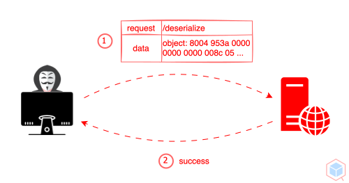
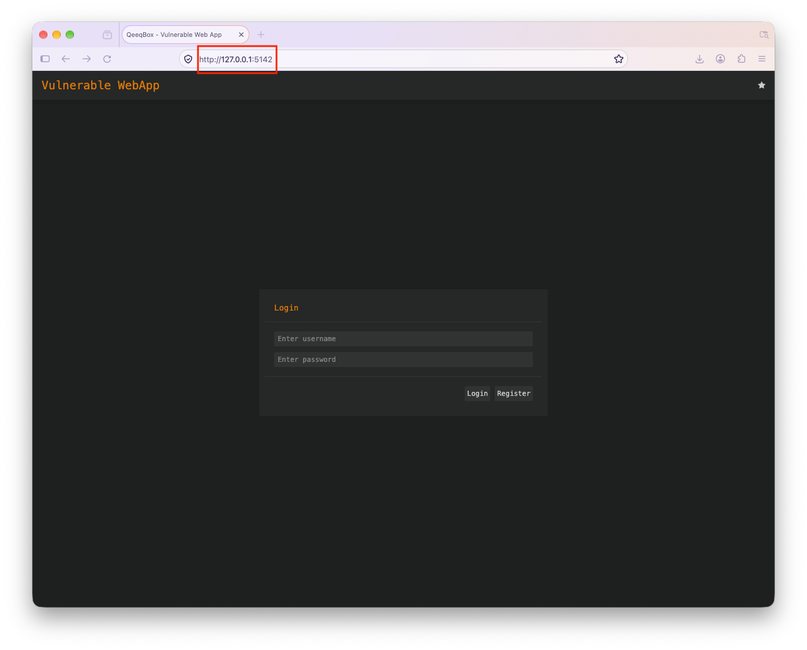
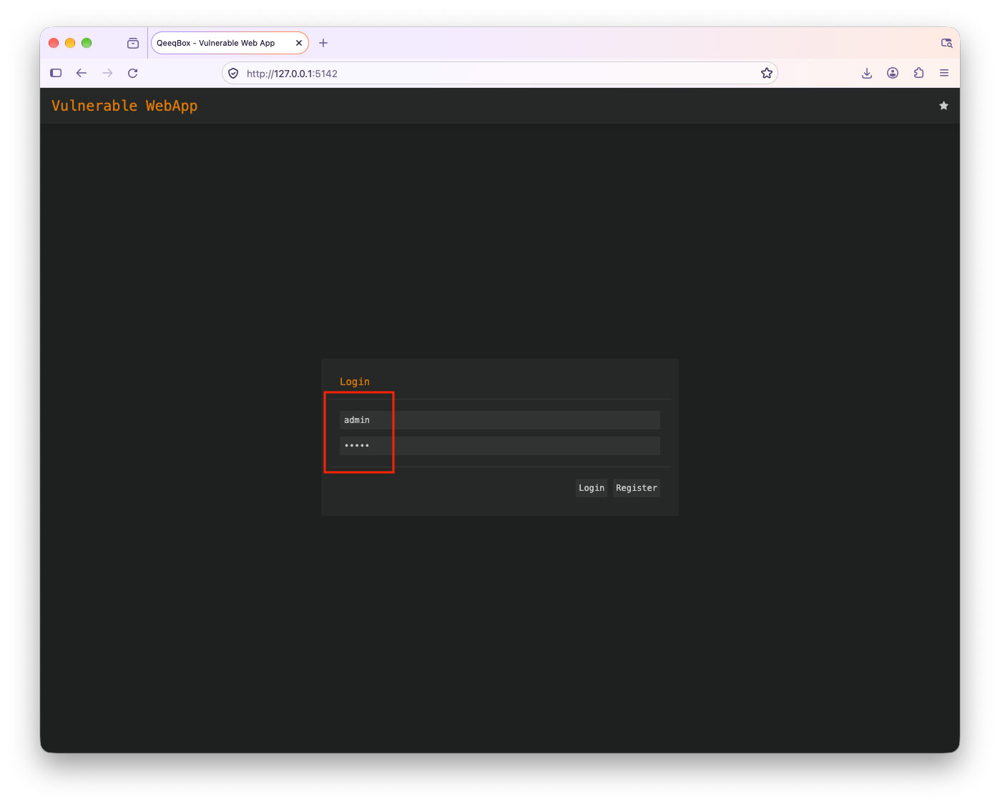
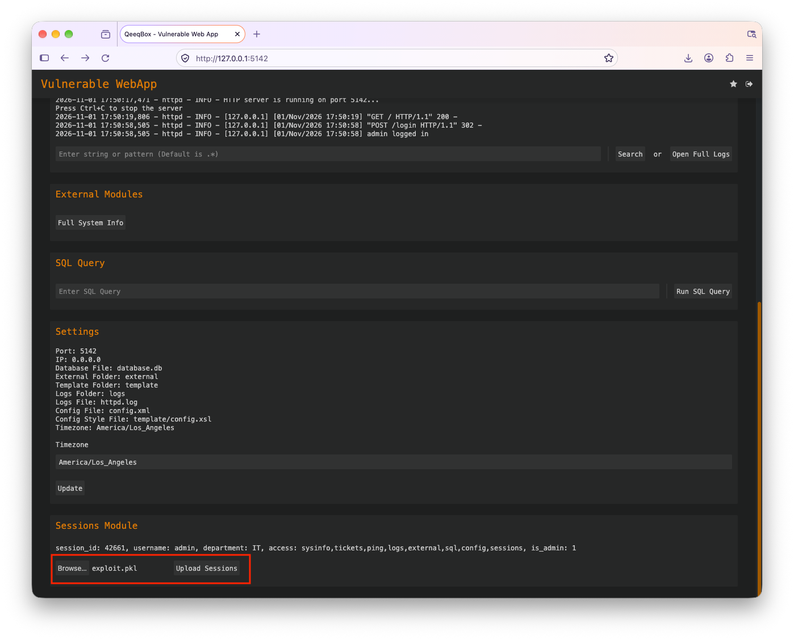
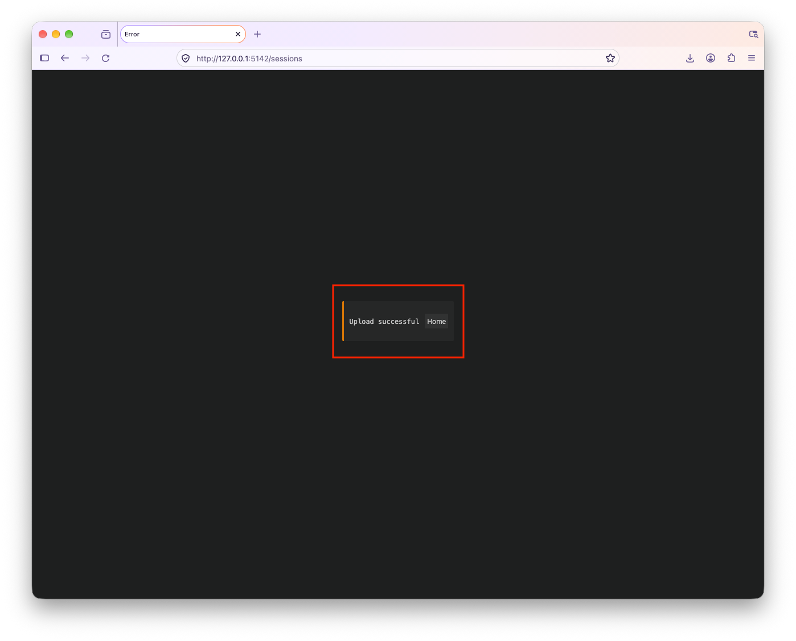

<p align="center"> </p>

Insecure Deserialization is a security vulnerability that occurs when an application deserializes untrusted or modified data without validating its integrity. Attackers can then manipulate serialized objects, potentially causing unauthorized actions, data tampering, privilege escalation, or remote code execution.

Serialization converts an object or data structure into a format that can be stored or transmitted, such as JSON, XML, or binary data. Deserialization reverses this process by converting serialized data back into an object. When applications deserialize untrusted data without adequate security measures, attackers may manipulate the data or exploit unsafe object-handling behaviors.

## How Insecure Deserialization Works
1. Serialized Data: An application serializes objects or data structures into a format suitable for storage or transmission, such as session data, user preferences, or application state.
2. Untrusted Data Input: The application accepts serialized data from external or user-controlled sources, such as web requests, cookies, API requests, or uploaded files.
3. Malicious Data Manipulation: An attacker modifies the serialized data or crafts a harmful serialized object to alter application behavior, change object properties, or trigger unintended functionality.
4. Unsafe Deserialization: The application deserializes the manipulated data without adequately validating its contents, verifying its integrity, or restricting the types of objects that can be instantiated.
5. Exploitation: The application processes the manipulated object, potentially allowing the attacker to change application state, bypass security controls, escalate privileges, or execute arbitrary code, depending on the application and the deserialization mechanism.
    
## Impact of Insecure Deserialization
- Remote Code Execution: Unsafe deserialization may let an attacker execute arbitrary code on the application server.
- Privilege Escalation: Modified object properties may let an attacker gain elevated privileges or impersonate another user.
- Authentication Bypass: An attacker may alter serialized session or authentication data to bypass authentication mechanisms.
- Authorization Bypass: Tampered objects may change user roles, permissions, or access-control attributes.
- Data Manipulation: Attackers may modify application objects, transactions, user records, or other sensitive data.
- Sensitive Information Disclosure: Exploitation may reveal confidential information stored in serialized objects or accessible through the application context.
    
## Mitigating Insecure Deserialization
- Avoid Deserializing Untrusted Data: Do not deserialize data from untrusted sources unless absolutely necessary. Prefer simpler data formats and safer data-handling practices. 
- Use Safe Serialization Formats: Prefer formats such as JSON that do not inherently support arbitrary object instantiation, while still validating the data being processed.
- Implement Input Validation: Validate the structure, data types, expected values, and size of serialized data before processing it.
- Restrict Deserialization Types: When deserialization is necessary, configure libraries to allow only explicitly permitted object types instead of arbitrary classes.
- Apply the Principle of Least Privilege: Run applications and deserialization processes with the minimum permissions necessary for their intended functions.
- Avoid Unsafe Object Hooks: Review constructors, callbacks, and other object-handling methods to prevent unintended execution during deserialization.
- Keep Serialization Libraries Updated: Use supported versions of serialization and deserialization libraries and regularly apply security updates.
- Implement Proper Access Controls: Enforce authentication and authorization independently of values contained within serialized objects.
- Perform Security Testing: Conduct code reviews and security testing to identify unsafe deserialization practices and ensure that manipulated serialized data cannot compromise application security.

## Insecure Deserialization Example
Clone this current repo recursively
```sh
git clone --recurse-submodules https://github.com/qeeqbox/insecure-deserialization
```
Run the webapp using Python
```sh
python3 insecure-deserialization/vulnerable-web-app/webapp.py
```
Open the webapp in your browser 127.0.0.1:5142
<p align="center"> </p>
Use the default credentials (username: admin and password: admin) to login
<p align="center"> </p>
In the Sessions section, find the serialized object (payload.pkl), and upload it
<p align="center"> </p>
After the upload is successful
<p align="center"> </p>
The payload is executed on the backend

```sh
Last login: Sun Nov  1 13:10:31 on ttys001
user@users-Mac-mini vulnerable-web-app % python3 webapp.py
Reading Config File
Logging Started
Deleting old database.db
Simulating Users Entering Login Credentials
Database Timezone to America/Los_Angeles (-8 hours)
Creating new database.db
HTTP server is running on port 5142... 
Press Ctrl+C to stop the server
[127.0.0.1] [01/Nov/2026 17:50:19] "GET / HTTP/1.1" 200 -
[127.0.0.1] [01/Nov/2026 17:50:58] "POST /login HTTP/1.1" 302 -
[127.0.0.1] [01/Nov/2026 17:50:58] admin logged in
[127.0.0.1] [01/Nov/2026 17:50:58] "GET / HTTP/1.1" 200 -
Injected via __import__!
[127.0.0.1] [01/Nov/2026 17:51:45] "POST /sessions HTTP/1.1" 200 -
```

## Code
When a user uploads a sessions file, the file gets processed using pickle.loads() function, the logic does not check user input
```py
elif parsed_url.path == "/sessions":
    files = self.handle_upload(self.headers, post_request_raw_data)
    if files:
        pickle_loads(files[0][1])
        self.send_content(200, [('Content-type', 'text/html')],self.msg_page(f"Upload successful".encode("utf-8"), b""))
        return
    else:
        self.send_content(200, [('Content-type', 'text/html')],self.msg_page(f"Upload failed".encode("utf-8"), b""))
        return
```
